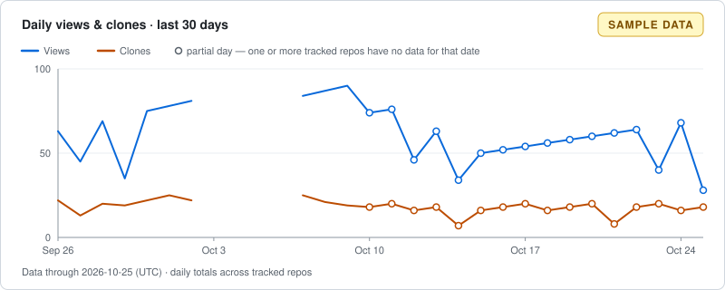

# Traffolio

> **Your GitHub traffic history, stored in your own repository.**  
> **No server. No database. Just GitHub.**

GitHub's Traffic API only returns the last 14 days of views and clones. Traffolio runs on GitHub Actions, collects views and clones for your repositories every day, and stores the history as JSON in your own **private** repository, with a dashboard rendered right here in this README.

> **No server. No database. Just GitHub.** means there is nothing for you to host or operate. It does not mean GitHub infrastructure is unused: Actions runs the collector, Git stores the data, and the README displays it.

<!-- TRAFFOLIO:START -->
**No traffic data collected yet.** The dashboard below is sample data. After the first collection run, this block is replaced with your real numbers. See [Setup](#setup).



[See the full sample section (sample data)](docs/demo/README-section.md)
<!-- TRAFFOLIO:END -->

## What it is, and what it is not

Traffolio is an open-source GitHub template. You create your own private copy, register one token, and a daily workflow keeps a long-term, per-day history of **Views** and **Clones** for the repositories your personal account owns, so you can compare them in one place.

It is not:

- a SaaS, backend, hosted database, or anything outside your GitHub account (no sign-up, billing, or Traffolio account);
- a real-time tracker, a visitor identity tracker, or a per-visit log. It is a **daily** history;
- a way to recover data older than 14 days that GitHub never gave you;
- a tool for other people's or organizations' repositories. Only repositories owned by the token's personal account are collected;
- supported on a public Traffolio repository. A public Traffolio repo is refused (see [Security](#security)).

## How it works

1. A scheduled GitHub Actions workflow (`.github/workflows/collect.yml`) runs once a day. You can also run it manually.
2. It lists your owned repositories, applies the filters in `traffolio.config.yml`, and fetches the latest 14 days of daily views and clones for each one.
3. The results are merged into JSON files under `data/`. Each day is overwritten (upserted) by repository ID and UTC date, so re-running never double-counts.
4. The README dashboard (between the `TRAFFOLIO` markers) and `assets/traffic.svg` are regenerated from that JSON. Only that marked block is rewritten; the rest of this README is yours.
5. If any file changed, the workflow commits it with `GITHUB_TOKEN`. If nothing changed, there is no commit.

## Setup

1. On the Traffolio template repository, click **Use this template**.
2. Create the new repository under your personal account and set it to **Private**. A public Traffolio repository is refused.
3. Review `traffolio.config.yml` (see [Configuration](#configuration)). The default is `include_private: false`.
4. Create a fine-grained personal access token (GitHub Settings → Developer settings → Personal access tokens → Fine-grained tokens):
   - Resource owner: your own GitHub account
   - Repository access: **All repositories**, or only the repositories you pick (then only those can be collected)
   - Repository permissions: **Administration: Read-only** (Metadata: Read is included automatically)
5. In your new Traffolio repository, add the token as the Actions secret **`TRAFFIC_TOKEN`** (Settings → Secrets and variables → Actions).
6. Enable Actions for the repository if needed, then run the workflow manually: Actions → **Traffolio Collect** → **Run workflow** (`workflow_dispatch`).
7. Open the run's Summary to check the result, then confirm the README dashboard above was updated.

Secrets are not copied when a repository is created from a template. The scheduled workflow can run before you add `TRAFFIC_TOKEN`; that run fails with a message saying `TRAFFIC_TOKEN` is not registered, which is expected until step 5 is done.

### Why Administration: Read

For fine-grained tokens, GitHub's REST docs list **Administration: Read** as the permission required by the traffic endpoints, so the token needs it. Traffolio uses it read-only and calls exactly these APIs:

| API | Token | Purpose |
|---|---|---|
| `GET /user` | `TRAFFIC_TOKEN` | Identify the token owner |
| `GET /user/repos?affiliation=owner` | `TRAFFIC_TOKEN` | List repositories you own (paginated) |
| `GET /repos/{owner}/{repo}/traffic/views?per=day` | `TRAFFIC_TOKEN` | Daily views |
| `GET /repos/{owner}/{repo}/traffic/clones?per=day` | `TRAFFIC_TOKEN` | Daily clones |
| `GET /repos/{GITHUB_REPOSITORY}` | `GITHUB_TOKEN` | Check that Traffolio itself is private and is not the template |

The default `GITHUB_TOKEN` cannot read other repositories' traffic, so it cannot replace the PAT. The workflow only needs `contents: write` for the commit. Notes on the API versions and behavior are in [docs/github-api-notes.md](docs/github-api-notes.md).

## Security

- **Never make this repository public.** Traffic numbers and the full Git history become public the moment you do, and a later detection by the collector cannot undo that. If you want a public dashboard, create a clean new repository instead.
- The token lives only in Actions Secrets. It is never written to data files, config, logs, the run Summary, or the SVG, and error messages do not dump raw HTTP responses.
- `include_private` defaults to `false`, so private repositories are not collected unless you opt in.
- **Visibility is re-checked on every run.** Traffolio calls `GET /repos/{GITHUB_REPOSITORY}` each time instead of trusting the event payload. Each collected repository's visibility is also re-read and stored; if a repository became private while `include_private` is `false`, that repository is no longer collected (its past data stays).
- **Fail closed.** If Traffolio is public, or its visibility cannot be determined, nothing is collected or committed. If the repository is the template origin (`is_template`), the run exits successfully with a notice and collects nothing.

What failures look like in Actions:

| Situation | Data | Run result |
|---|---|---|
| Missing `TRAFFIC_TOKEN`, 401, `GET /user` fails | Nothing written | Failed (exit 1) |
| Traffolio repo is public, or visibility cannot be determined | Nothing written | Failed (exit 1) |
| All selected repositories failed | Nothing written | Failed (exit 1) |
| Some repositories hit transient errors (5xx, network, rate limit) after retries | Successes are committed | Failed (exit 2) |
| A repository returns 403/404 (no permission or traffic not available) | Status recorded, no numbers written | Succeeds with a warning; shown as `—` |
| Template origin repository | Nothing written | Succeeds (exit 0) with a notice |

A failed run sends GitHub's normal notification, so a broken token does not go unnoticed.

## Data

Everything lives in your repository. These files are created by collection (the template ships with an empty `data/`):

```text
data/
  index.json                 repo ID -> name, visibility, status, star/fork snapshot
  status.json                data-through date, per-repo last success and error class
  traffic/<repo_id>/YYYY-MM.json   daily metrics for one repo and month
assets/traffic.svg           generated README chart
```

Per-month file shape:

```json
{
  "schemaVersion": 1,
  "repositoryId": 12345678,
  "month": "2026-10",
  "days": {
    "2026-10-25": { "views": 112, "uniqueViews": 45, "clones": 8, "uniqueCloners": 6 }
  }
}
```

- **Present vs missing.** A date key in `days` means it was collected, even when every value is `0`. No key means missing: the day was never collected (failed run, no permission, or a gap longer than 14 days). Missing days are never summed as zero or interpolated; the dashboard shows them as `—`.
- **Data-through date, not run date.** The Traffic API lags by about two days, so the README shows the latest stored date as "data through", not today's date.
- **UTC only.** All dates and periods are UTC. There is no timezone setting.
- **Events, not people.** Totals are event counts summed across the tracked repositories. Daily unique counts are stored but are not added across days or repositories, so there is no "monthly unique visitors". CI checkouts of your repositories can count as clones.
- **Stars and forks are snapshots** taken at collection time, not a reconstructed history.
- **Nothing is deleted.** If a repository is deleted, renamed, or filtered out later, its old data stays. Repositories are keyed by their numeric ID, so a rename continues the same history.
- Files have a fixed ordering and contain no run timestamps, so a re-run on the same day produces no diff and no commit.

## Configuration

`traffolio.config.yml` has a single `repositories` section. Unknown keys and wrong types are rejected with an error, and a missing key uses its default.

| Key | Default | Meaning |
|---|---|---|
| `include` | `["*"]` | Glob patterns; a repository must match at least one |
| `exclude` | `[]` (the shipped file sets `["test-*", "playground-*"]`) | Glob patterns; any match removes the repository. Exclude always wins over include |
| `include_private` | `false` | Also collect private repositories |
| `include_forks` | `false` | Also collect forks |
| `include_archived` | `false` | Also collect archived repositories |
| `include_self` | `false` | Also collect the Traffolio repository itself. Still requires `include_private: true`, since Traffolio is private |

Matching rules:

- Patterns are globs matched against the repository **name** only (no owner), and matching is case-insensitive.
- Traffolio itself is recognized by its repository ID (from `GITHUB_REPOSITORY`), not by name.
- Only repositories owned by the token's account are candidates; repositories you merely contribute to are ignored.

## Operations

- **Schedule.** The workflow runs daily at 03:37 UTC (an off-the-hour time, because GitHub delays runs at the top of the hour). Scheduled runs can still be delayed or skipped. If one is missed, run it manually from Actions → **Traffolio Collect** → **Run workflow**. A missed day is recoverable as long as you re-run within 14 days; the dashboard's data-through date and `—` cells show any gap.
- **Token expiry.** Fine-grained tokens expire. Renew before the expiry date and replace the `TRAFFIC_TOKEN` secret. If collection is broken for more than 14 days, the older days are lost permanently because GitHub no longer provides them.
- **Branch protection.** Rules that block pushes to the default branch also block the bot's commit. See Troubleshooting.
- **Private repository traffic.** Whether traffic is available for private repositories depends on your GitHub plan and the token's permissions. Unavailable repositories are recorded in `data/status.json` and shown as `—`, never as zero.
- **Actions minutes.** A daily run takes roughly 1 to 2 minutes, about 30 to 60 minutes a month. Private repositories draw on your account's included Actions minutes, so compare that with your plan.
- **Adding or removing repositories.** Each run rediscovers your repositories, so new ones are picked up automatically. Removed or excluded ones keep their history.

### Development

Requires Node 24.

```sh
npm install
npm test            # unit tests
npm run typecheck   # type check only
npm run build       # compile to dist/
npm run demo        # build, then regenerate docs/demo/ from fixtures/ (no GitHub access needed)
```

`npm run demo` runs the real reporter on fake data in `fixtures/` and writes the sample images and section in `docs/demo/`.

### Troubleshooting

- **The run failed because `TRAFFIC_TOKEN` is missing, or with a 401.** The secret is missing, expired, or revoked. Create a new token as in [Setup](#setup) step 4 and update the secret, then re-run.
- **The run failed because the repository is public.** Make it private again. Anything committed while it was public is already exposed, so consider the history compromised and start from a fresh private repository if the data matters.
- **The commit/push step failed (branch protection).** The workflow pushes to the default branch as `github-actions[bot]` using `GITHUB_TOKEN`. If branch protection or a ruleset requires pull requests, reviews, or status checks, that push is rejected. Allow the GitHub Actions bot to bypass the rule for this repository, or relax the rule on the default branch. Collected data from the failed run is not committed, and the next run collects it again.
- **The push was rejected because of a concurrent push.** If you pushed at the same moment, the workflow rebases and retries once. If it still fails, just re-run the workflow.
- **A repository shows `—`.** The API returned 403/404 for it (permissions or plan), or it has not been collected yet. Check `data/status.json` for the reason, and check that the token covers that repository.
- **Some repositories failed (exit 2).** These were transient errors such as rate limits or 5xx responses. Successful repositories were committed; re-run the workflow to retry the rest.

## License

See [LICENSE](LICENSE). The full product specification is in [Traffolio_MVP.md](Traffolio_MVP.md).
